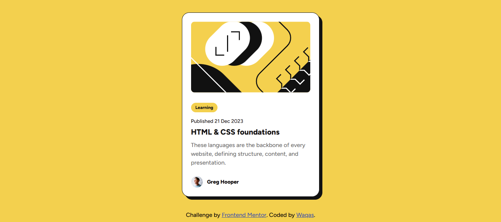

# Frontend Mentor - Blog preview card solution

This is a solution to the [Blog preview card challenge on Frontend Mentor](https://www.frontendmentor.io/challenges/blog-preview-card-ckPaj01IcS). Frontend Mentor challenges help you improve your coding skills by building realistic projects. 

## Table of contents

- [Overview](#overview)
  - [The challenge](#the-challenge)
  - [Screenshot](#screenshot)
  - [Links](#links)
- [My process](#my-process)
  - [Built with](#built-with)
- [Author](#author)

## Overview

### The challenge

Users should be able to:

View the optimal layout for the card depending on their device's screen size
See hover and focus states for all interactive elements on the page

### Screenshot

### Links

- Solution URL: [Get Code](https://github.com/battleshopventureswaqas-blip/Blog-preview-card)
- Live Site URL: [Live Demo](https://battleshopventureswaqas-blip.github.io/Blog-preview-card/)

## My process

### Built with

- Semantic HTML5 markup
- CSS custom properties
- Flexbox
- CSS Grid
- Mobile-first workflow

## Author

- GitHub - [Waqas Siddique](https://github.com/battleshopventureswaqas-blip)
- Frontend Mentor - [Waqas](https://www.frontendmentor.io/profile/battleshopventureswaqas-blip)
- Linkedin - [Muhammad Waqas Siddique](https://www.linkedin.com/in/muhammad-waqas-siddique-9538213b7/)

